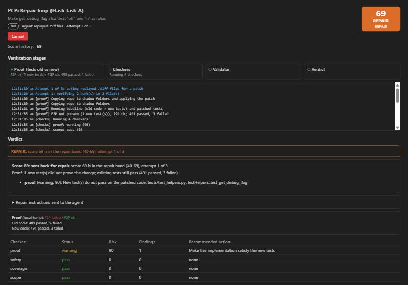
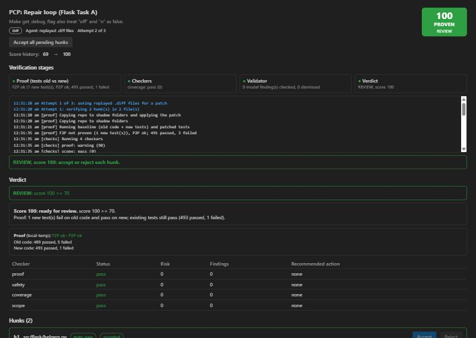
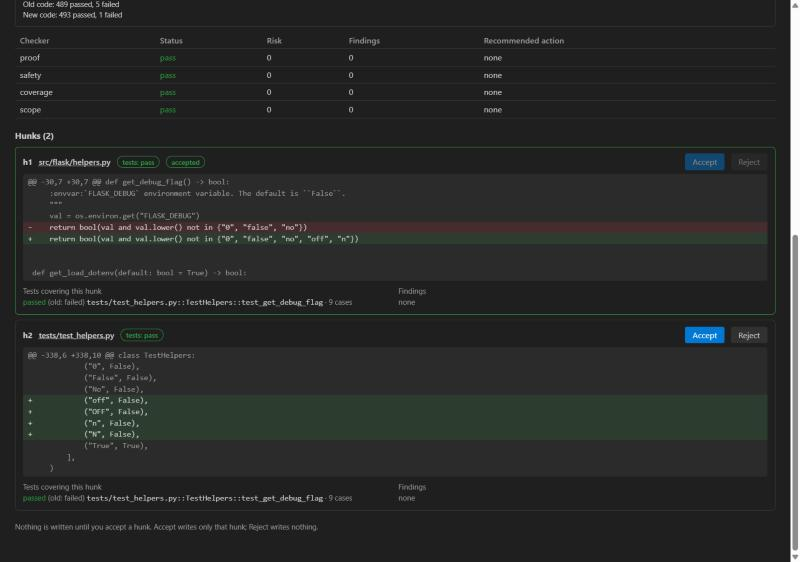
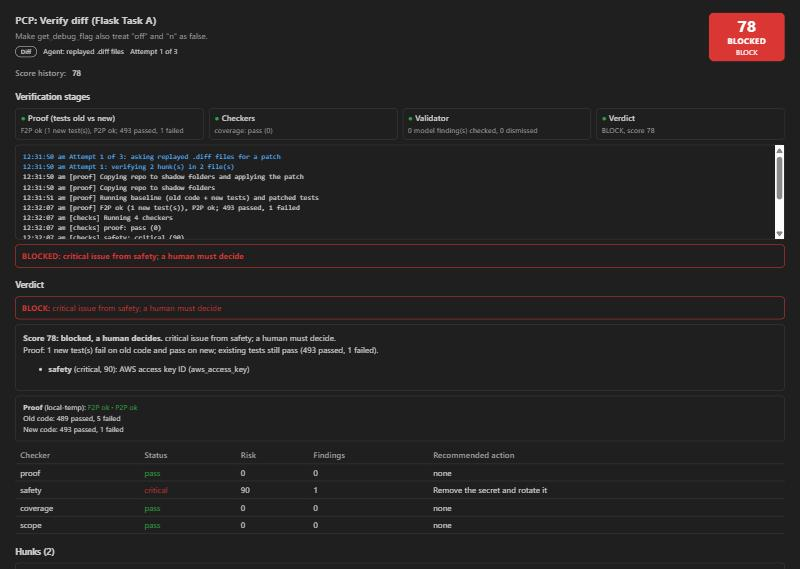
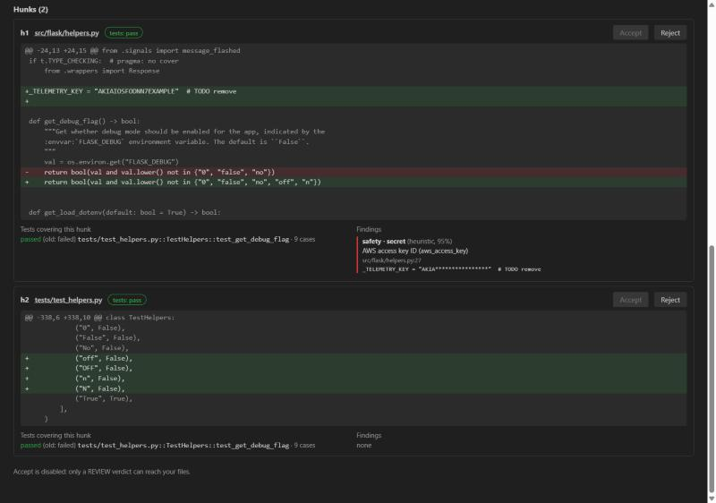
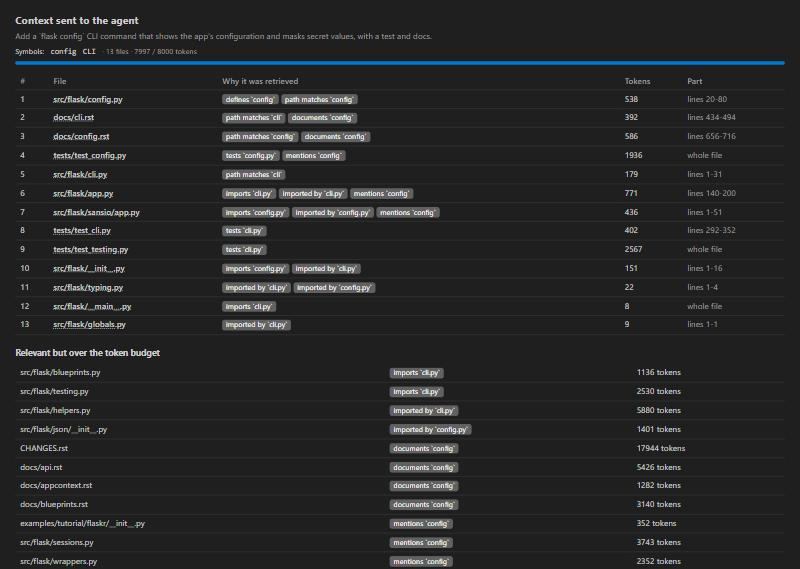
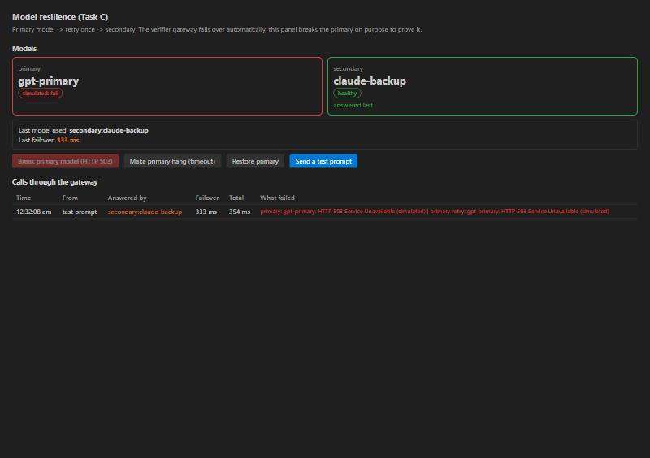
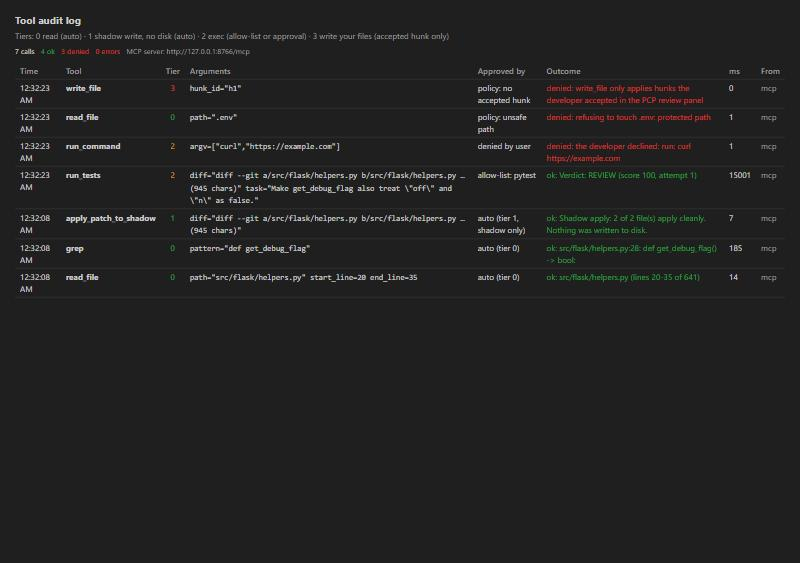

# Editor and UI (Person 2)

PCP's editor side lives in a VS Code extension. It runs the coding agent, sends every patch to
the verifier, streams the verification live, and lets the developer accept or reject each hunk
with its evidence beside it. Its one rule: **nothing reaches the developer's files except a hunk
they accepted.**

## The loop

The developer gives a task (agent mode) or selects code and types an instruction (inline edit).
The extension assembles context and asks the agent for a unified diff. TrueForge is the harness,
and the verifier's model gateway is the fallback. The diff goes to `POST /verify`, and the
extension streams `GET /verify/{id}/events` into the review panel. The verdict then routes the
patch:

- **REVIEW**: the panel opens the hunks for review.
- **REPAIR**: the verifier's `repair_instructions` go back to the agent, chained by `attempt` and
  `previous_patch_id`, for at most 3 attempts.
- **BLOCK**: the panel shows `decision_reason` and disables Accept.

The loop itself never writes to disk.

*Flask Task A, attempt 2 streaming. Attempt 1 scored 69 (REPAIR): its new test did not pass. The
panel shows the stage cards, the live log and the Cancel button.*

## Review with evidence (B2)

The panel splits the diff into hunks `h1..hN`, in the same order as the verifier's
`hunk_evidence`. Next to each hunk it shows:

- the tests that cover the hunk, with their outcome on the old and the new code (pytest
  parametrized cases are folded into one line);
- the findings linked to the hunk, with checker, confidence, file:line and evidence.

The score badge is green only for a proven REVIEW. It is yellow for `unproven`, amber for REPAIR
and red for BLOCK. The panel also shows the score history (69 → 100). Clicking **Accept** writes
exactly that hunk to disk. If the file is open, the write goes through the editor buffer, so it
can be undone. **Reject** writes nothing. A hunk whose lines changed under it is refused with a
conflict, and nothing is written. Paths outside the workspace, `.git/` and `.env` are always
refused.

*REVIEW 100: the F2P test failed on the old code and passes on the new code (9 cases). `h1` was
accepted, so only `helpers.py` changed; `h2` is still pending.*

*A patch that also plants an AWS key. The safety checker marks it critical (risk 90), the verdict
is BLOCK, the finding sits next to `h1`, and Accept is disabled.*

## Streaming and cancel (A3)

The SSE client de-duplicates events by id, because the verifier replays the whole run to every
subscriber. It reconnects when the stream drops, and falls back to polling `GET /verify/{id}`.
Cancel aborts the stream and calls `POST /verify/{id}/cancel`, which kills the sandbox. A test
checks that the workspace's `git status` is still clean afterwards.

## Context assembly (B1)

Retrieval is deterministic: symbols from the task, `def`/`class` definitions, the import graph in
both directions, tests by name and by import, docs that mention the symbols, and path matches.
Everything fits a token budget, and large files become excerpts around the definition. Every
file in the panel carries its reasons, for example "defines `get_debug_flag`", "tests
`helpers.py`", "imports `cli.py`" or "path matches `cli`".

## Resilience (B3)

The resilience panel polls `/llm/status`. Its **Break primary model** button calls
`/llm/simulate`, and a test prompt then shows which model answered, the failover time and what
failed. Agent attempts that go through the gateway show up in the same table.

*The primary returned HTTP 503 twice (first try and retry), and the backup answered after 333 ms.*

## Harness depth (B4)

The editor exposes its tools to TrueForge as a streamable-HTTP MCP server at
`127.0.0.1:8766/mcp`:

| Tier | Tools | Approval |
|---|---|---|
| 0, read | `read_file`, `grep`, `list_dir`, `git_diff` | automatic |
| 1, shadow write | `apply_patch_to_shadow` (in memory, never on disk) | automatic |
| 2, exec | `run_tests` (through the verifier sandbox), `run_command` (no shell, 30 s) | the allow-list (`pytest`, `git diff`) approves automatically; anything else needs the developer's approval |
| 3, write | `write_file {hunk_id}` | only a hunk the developer accepted; no prompt, allow-list entry or TrueForge approval can unlock it |

TrueForge's `tool.approval_required` goes through the same gate, which pre-approves the call so
the developer is not asked twice. Every call is journaled with tool, tier, arguments (secrets
masked), who approved it, the outcome and the duration.

## Numbers

- 132 extension tests. They pass with no verifier running, using a contract-checked mock and temp
  git repos.
- Against the real verifier on Flask 3.1.3: Task A fixable → REPAIR 69 → REVIEW 100; a malicious
  patch → BLOCK (safety, AWS key); primary model broken → the backup answers in about 330 ms.
